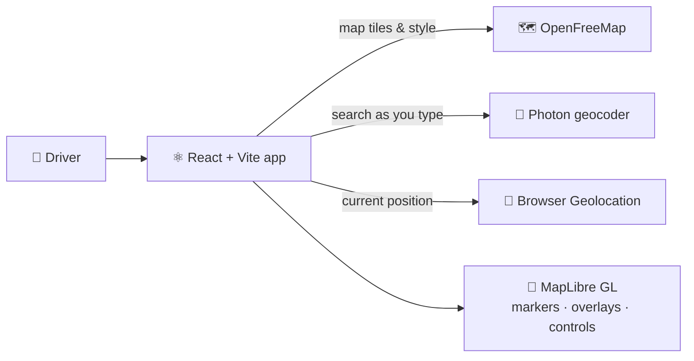

<p align="center">
  
</p>

<p align="center">
  
  
  
  
  
</p>

<p align="center">
  <b>Every Badger knows the struggle: circling campus, hunting for a spot, late for class.<br/>Park Madison is a map-first web app that helps drivers find practical parking near UW–Madison and downtown.</b>
</p>

---

## ✨ Features

- 🗺️ **Interactive vector map:** smooth, GPU-rendered map of Madison built on **MapLibre GL** with **OpenFreeMap** tiles
- 🔎 **Destination search with autocomplete:** type where you're headed and get live suggestions from the **Photon** geocoder (OpenStreetMap data)
- 📍 **Destination pin:** selecting a result drops a marker and flies the map to it
- 🧭 **"Locate me":** one tap uses the browser's Geolocation API to show where you are
- 🟥 **Service-area overlay:** a highlighted polygon covers campus and downtown, with everything outside softly masked
- 📱 **Mobile-first layout:** header search, map controls and a bottom parking sheet designed for one-handed use

---

## 🏗️ Architecture



All mapping runs on **open data and open-source tools**, so there are no paid map APIs or API keys.

---

## 🚀 Getting Started

```bash
git clone https://github.com/JeevanJyot55/park-madison.git
cd park-madison
npm install
npm run dev
```

Then open **http://localhost:5173**.

---

## 📁 Project Structure

```
park-madison/
├── index.html
├── src/
│   ├── App.jsx        # Map, search, geolocation, service-area overlay
│   ├── main.jsx
│   └── styles.css
└── vite.config.js
```

---

## 🗺️ Roadmap

- [x] Madison map screen
- [x] Locate-me control
- [x] Destination search with autocomplete + pin
- [x] Campus/downtown service-area overlay
- [ ] 🅿️ Parking garages, lots and street-parking zones on the map
- [ ] 💲 Rates, hours and permit rules for each option
- [ ] 🚶 Walking distance and time from parking to destination
- [ ] 🏟️ Game-day and event parking alerts
- [ ] 🟢 Live availability where city data is available
- [ ] 🌐 Deploy publicly

---

<p align="center">
  Built by <a href="https://github.com/JeevanJyot55"><b>Jeevan Jyot Singh</b></a> · <a href="https://www.linkedin.com/in/jeevanjyotsingh">LinkedIn</a> · <a href="https://jeevanjyot55.github.io">Portfolio</a>
</p>
